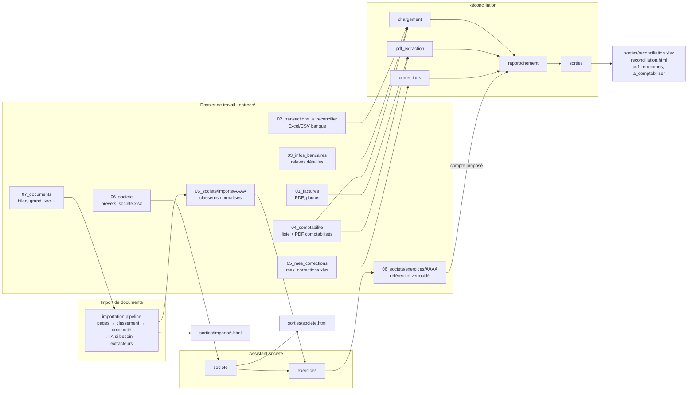

# Comprendre Reconsigliere

Cette documentation explique ce que fait chaque partie du programme, quels fichiers elle lit et écrit, et ce qu'un
changement implique. Elle est tenue à jour à chaque modification du code : un contrôle sur GitHub refuse une modification
d'un module qui ne met pas sa page à jour (voir « Comment cette documentation reste à jour » plus bas).

## Par où commencer

| Je veux… | Page |
|---|---|
| Voir le programme d'un coup d'œil | ce fichier, schéma ci-dessous |
| Savoir ce que fait un module et ce qui casse si on le change | [modules/](modules/) (une page par module) |
| Voir qui utilise qui | [carte.md](carte.md) (générée depuis le code) |
| Savoir quel fichier est lu ou écrit, et ses colonnes | [donnees.md](donnees.md) |
| Savoir où le programme apprend de mes corrections | [apprentissage.md](apprentissage.md) |
| Savoir pourquoi un choix a été fait | [decisions.md](decisions.md) |
| Voir ce qui a changé de version en version | [CHANGEMENTS.md](../CHANGEMENTS.md) |

## Les trois parties du programme

1. **Réconciliation** : relie chaque transaction bancaire à sa pièce (facture, reçu) et dit si elle est déjà en comptabilité.
2. **Import de documents** : lit un bilan, un compte de résultat, un grand livre, un plan comptable ou une annexe (PDF, photo, Excel)
   et en fait un classeur normalisé.
3. **Assistant société** : l'état de la société au jour le jour (brevets, projets, revenus, journal) et un référentiel par exercice,
   validé puis verrouillé, qui sert à proposer un compte pour chaque transaction.

## Le flux des fichiers



La fenêtre ([modules/fenetre.md](modules/fenetre.md)) n'est qu'un tableau de commande : chaque bouton appelle un des modules ci-dessus.
Le lanceur Windows ([modules/windows/demarrer.md](modules/windows/demarrer.md)) met le programme à jour depuis GitHub avant d'ouvrir la fenêtre.

## Où sont les choses

- Le **code** est dans `src/reconsigliere/` ; l'installation Windows le place dans `%LOCALAPPDATA%\Reconsigliere\app`.
- Tes **données** sont dans le dossier de travail (`Documents\Reconsigliere` par défaut), jamais dans le dépôt GitHub.
- Les **réglages** (dossier choisi, clé API, modèle d'IA) sont dans `%APPDATA%\Reconsigliere\reglages.json`.
- Les **tests** sont dans `tests/`, sur des données fictives ; ils tournent sur GitHub à chaque envoi.

## Comment cette documentation reste à jour

Chaque page de module a deux parties :

- **le texte écrit à la main**, avec quatre rubriques obligatoires : « À quoi il sert », « Ce qu'il lit », « Ce qu'il écrit »,
  « Ce qui casse si on le change » ;
- **une partie générée** depuis le code (dépendances, modules qui l'utilisent, bibliothèques, fonctions), entre
  `<!-- debut-auto -->` et `<!-- fin-auto -->`, ainsi que toute la page [carte.md](carte.md).

Le script `outils/docs.py` fait le travail :

```bash
python outils/docs.py                   # régénère les parties automatiques (et crée la page d'un nouveau module)
python outils/docs.py --verifier        # échoue si une page manque, est incomplète ou n'est pas à jour
python outils/docs.py --depuis main     # échoue si un module a changé depuis main sans que sa page change
```

Sur GitHub, le contrôle « Documentation » lance les deux vérifications à chaque envoi et à chaque pull request :
une modification d'un module sans mise à jour de sa page ne peut pas passer au vert.
La même règle est écrite dans [CLAUDE.md](../CLAUDE.md) pour toute session de Claude qui travaille sur le dépôt.

Quand un choix important est fait (un seuil, un format de fichier, une règle comptable), il s'ajoute à [decisions.md](decisions.md).
