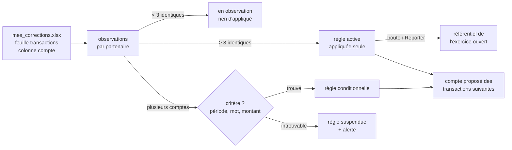

# Où le programme apprend

« Apprendre », dans Reconsigliere, veut dire : réutiliser ce que tu as corrigé ou validé pour mieux proposer la fois suivante.
Il n'y a pas d'apprentissage caché : tout ce que le programme retient est dans un fichier que tu peux ouvrir, et l'onglet
**Apprentissage** de la fenêtre le montre. État au 26.11.2026 (version 0.8.0).

## Comment une correction devient une règle

1. Tu corriges le compte d'une transaction : feuille `transactions` de `mes_corrections.xlsx`, colonne `compte`
   (avec l'`id_transaction` copié depuis `sorties/reconciliation.xlsx`).
2. À la réconciliation suivante, chaque correction devient une observation pour le partenaire de la transaction.
3. **Moins de 3 corrections identiques** : la règle est « en observation », rien n'est appliqué (une seule correction peut être une faute).
4. **3 corrections identiques** (réglage `SEUIL_REGLE` dans `config.py`) : la règle devient **active**. Les autres transactions de ce
   partenaire reçoivent ce compte, avec l'origine « appris » et la fiabilité « 3 corrections sur 3 ».
5. **Si les corrections continuent** pour ce partenaire, le programme cherche pourquoi :
   - une correction isolée contraire ne change rien, mais une alerte la signale (« 1 correction contraire ») ;
   - si deux comptes reviennent chacun au moins deux fois, il cherche le critère qui les sépare : **la date** (tu as changé de compte
     à partir d'un jour), **un mot du libellé** (« CARBURANT » → 6200, « MARCHE » → 6000), **le montant** (moins de 468 CHF → 6000,
     au-delà → 1500). Critère trouvé : règle **conditionnelle**. Sinon : règle **suspendue**, rien n'est appliqué seul,
     et une alerte demande de trancher ;
   - si une règle simple avait été active et que tes corrections montrent autre chose, l'alerte le dit : « mon analyse se trompait ».
6. **Le compte unique était faux dans le référentiel** : si le référentiel de l'exercice range le partenaire sur 6500 et que tes
   corrections disent 6600, une alerte le signale et liste les autres partenaires rangés sur 6500 (même erreur possible, à vérifier).
   Le bouton « Reporter dans l'exercice ouvert » inscrit la correction dans le référentiel, datée et motivée.
7. Ordre de priorité pour chaque transaction : **ta correction**, sinon **la règle apprise**, sinon **le référentiel**. La colonne
   `origine_compte` de `sorties/reconciliation.xlsx` dit laquelle a servi.

Tout est **recalculé à chaque réconciliation** : supprimer une correction retire son effet. Seules tes annulations sont gardées
(feuille `regles_apprises` de `mes_corrections.xlsx` ; supprimer la ligne rétablit la règle).

## Ce qu'il retient aujourd'hui

### 1. Les règles de partenaires (`mes_corrections.xlsx`, feuille `partenaires`)

Tu écris « si le libellé bancaire contient `SWISSCOM`, le partenaire est `Swisscom` ». À chaque réconciliation, cette règle passe
avant tout le reste ([rapprochement](modules/rapprochement.md), étape partenaire), puis le partenaire compte pour 20 points
dans le score qui choisit la pièce. Une règle écrite une fois sert pour toutes les transactions futures.

### 2. Le compte habituel de chaque partenaire (référentiel de l'exercice, onglet `Partenaires`)

Quand un exercice est construit depuis le grand livre ([exercices](modules/exercices.md)), le programme note, pour chaque partenaire,
le compte le plus souvent utilisé avec lui (sans les comptes de banque, débiteurs, créanciers et TVA) et la part des écritures qui l'ont
utilisé. À la réconciliation, chaque transaction reçoit un « Compte proposé » d'après le référentiel de son exercice, avec cette fiabilité
(« 92 % sur 25 écritures, selon partenaire, référentiel 2024 »).

### 3. Les règles apprises de tes corrections de compte (colonne `compte`, module [apprentissage](modules/apprentissage.md))

Décrit plus haut. Visible dans l'onglet Apprentissage et dans `sorties/apprentissage.xlsx` (onglets `resume`, `regles`, `alertes`,
`corrections`).

### 4. Les liens imposés (`mes_corrections.xlsx`, feuille `transactions`)

Un PDF, un statut ou une explication donnés pour une transaction sont réappliqués à chaque lancement, pour **cette** transaction
seulement (identifiée par date, montant et libellé).

## Ce qu'il ne retient pas encore

- Une pièce liée à la main n'apprend rien au score : le même fournisseur sera de nouveau proposé avec le même score le mois suivant.
- Une correction de **partenaire** ne devient pas une règle de partenaire : il faut l'écrire dans la feuille `partenaires`.
- Le type de page que tu choisis à la main pendant un import n'est pas mémorisé : un document de même forme reposera la question.
- Les règles de classement des pages ([importation.classement](modules/importation/classement.md)) sont fixes, dans le code.
- Une règle apprise ne modifie jamais un référentiel d'elle-même : c'est toi qui la reportes (bouton) ; un exercice validé ne change pas.
