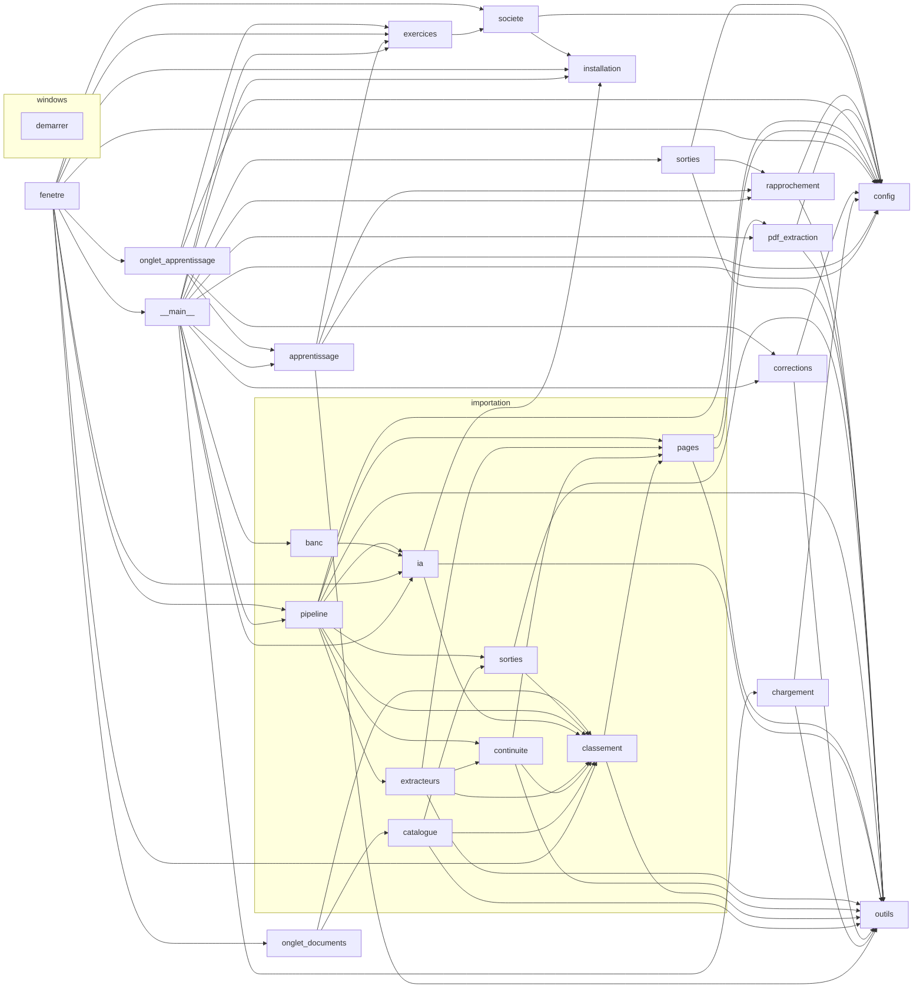

# Carte des modules

_Page générée par `python outils/docs.py` à partir du code : ne pas la modifier à la main._

Une flèche A → B veut dire « A utilise B » : changer B peut changer le comportement de A.

| Module | Fichier | Lignes | Utilisé par |
|---|---|---|---|
| [__main__](modules/__main__.md) | `src/reconsigliere/__main__.py` | 127 | fenetre |
| [apprentissage](modules/apprentissage.md) | `src/reconsigliere/apprentissage.py` | 474 | __main__, onglet_apprentissage |
| [chargement](modules/chargement.md) | `src/reconsigliere/chargement.py` | 146 | __main__ |
| [config](modules/config.md) | `src/reconsigliere/config.py` | 65 | __main__, apprentissage, chargement, corrections, fenetre, importation.pages, importation.pipeline, onglet_apprentissage, pdf_extraction, rapprochement, societe, sorties |
| [corrections](modules/corrections.md) | `src/reconsigliere/corrections.py` | 104 | __main__, onglet_apprentissage |
| [exercices](modules/exercices.md) | `src/reconsigliere/exercices.py` | 681 | __main__, apprentissage, fenetre, onglet_apprentissage |
| [fenetre](modules/fenetre.md) | `src/reconsigliere/fenetre.py` | 1057 | — |
| [importation.banc](modules/importation/banc.md) | `src/reconsigliere/importation/banc.py` | 67 | __main__ |
| [importation.catalogue](modules/importation/catalogue.md) | `src/reconsigliere/importation/catalogue.py` | 230 | onglet_documents |
| [importation.classement](modules/importation/classement.md) | `src/reconsigliere/importation/classement.py` | 107 | fenetre, importation.catalogue, importation.continuite, importation.extracteurs, importation.ia, importation.pipeline, importation.sorties, onglet_documents |
| [importation.continuite](modules/importation/continuite.md) | `src/reconsigliere/importation/continuite.py` | 93 | importation.extracteurs, importation.pipeline |
| [importation.extracteurs](modules/importation/extracteurs.md) | `src/reconsigliere/importation/extracteurs.py` | 302 | importation.pipeline |
| [importation.ia](modules/importation/ia.md) | `src/reconsigliere/importation/ia.py` | 108 | __main__, fenetre, importation.banc, importation.pipeline |
| [importation.pages](modules/importation/pages.md) | `src/reconsigliere/importation/pages.py` | 147 | importation.classement, importation.continuite, importation.extracteurs, importation.pipeline |
| [importation.pipeline](modules/importation/pipeline.md) | `src/reconsigliere/importation/pipeline.py` | 179 | __main__, fenetre |
| [importation.sorties](modules/importation/sorties.md) | `src/reconsigliere/importation/sorties.py` | 125 | importation.catalogue, importation.pipeline |
| [installation](modules/installation.md) | `src/reconsigliere/installation.py` | 148 | __main__, fenetre, importation.ia, societe |
| [onglet_apprentissage](modules/onglet_apprentissage.md) | `src/reconsigliere/onglet_apprentissage.py` | 208 | fenetre |
| [onglet_documents](modules/onglet_documents.md) | `src/reconsigliere/onglet_documents.py` | 234 | fenetre |
| [outils](modules/outils.md) | `src/reconsigliere/outils.py` | 79 | apprentissage, chargement, corrections, importation.catalogue, importation.classement, importation.continuite, importation.extracteurs, importation.ia, importation.pages, importation.pipeline, importation.sorties, pdf_extraction, rapprochement, sorties |
| [pdf_extraction](modules/pdf_extraction.md) | `src/reconsigliere/pdf_extraction.py` | 104 | __main__, importation.pages |
| [rapprochement](modules/rapprochement.md) | `src/reconsigliere/rapprochement.py` | 159 | __main__, apprentissage, sorties |
| [societe](modules/societe.md) | `src/reconsigliere/societe.py` | 648 | exercices, fenetre |
| [sorties](modules/sorties.md) | `src/reconsigliere/sorties.py` | 100 | __main__ |
| [windows.demarrer](modules/windows/demarrer.md) | `windows/demarrer.pyw` | 196 | — |
